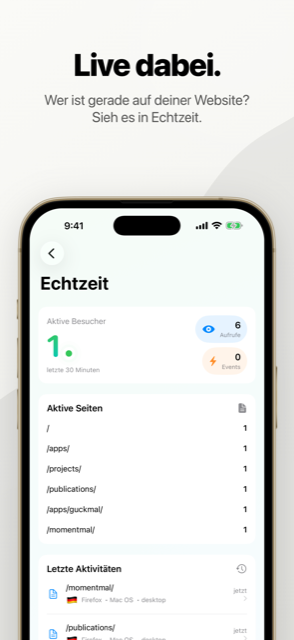
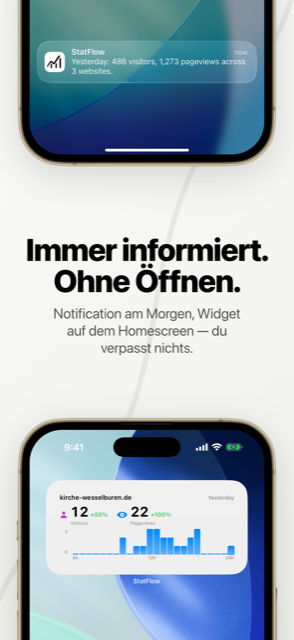

<p align="center">
  
</p>

<h1 align="center">StatFlow</h1>

<p align="center">
  The iPhone app for <a href="https://umami.is">Umami</a> and <a href="https://plausible.io">Plausible</a> —<br>
  the numbers of your own websites, without a detour through the browser.
</p>

<p align="center">
  <a href="README.md">Deutsch</a> · <b>English</b>
</p>

<p align="center">
  
  
  
  
</p>

## What it is about

Umami and Plausible count visits without tracking their visitors. Both have a
dashboard in the browser — on a phone that is tedious.

StatFlow brings the same numbers to your lock screen: how is the website doing
today, where do people come from, what do they read. Several accounts and both
providers side by side, in one app. Credentials stay in the device keychain and
the data on your own server — there is no service in between.

## Features

- **Overview** — visitors, page views, bounce rate and visit duration, also in real time
- **Reports** — pages, referrers, countries, devices, browsers and custom events
- **Comparisons** — any periods against each other, week over week, year over year
- **Annotations** — notes in the timeline ("newsletter sent", "relaunch") that
  explain afterwards why the numbers spiked
- **Widgets** — the key numbers on the home screen
- **Notifications** — a daily or weekly summary
- **Offline** — the last loaded numbers stay readable
- **Several accounts** — different providers and instances side by side
- German and English, light and dark mode

## Installation

**[Download on the App Store »](https://apps.apple.com/app/id6761671122)**

> In the App Store the app is called **StatsFlow** — *StatFlow* was already
> taken. In the source code it is StatFlow, the Xcode target `InsightFlow`.

To get started you need an Umami or Plausible account: enter the server address
and credentials in the app, pick your websites, done.

## Which servers work

| Provider | Required | Last tested against |
|----------|----------|---------------------|
| **Umami** | 3.0 or later, self-hosted or cloud | 3.3.0, 3.4.0 and 3.4.1 |
| **Plausible** | CE 2.1 or later, or cloud | CE 3.2.1 |

Umami 2.x answers in a different format and is not supported. Some reports need
newer versions — annotations and login via API key, for example, need Umami
3.4. The app detects what a server can do and hides the rest.

What works with which provider, and why, is described (in German) in
[docs/kompatibilitaet.md](docs/kompatibilitaet.md).

## Screenshots

| Overview | Website |
|----------|---------|
|  |  |

| Real time | Widgets and notifications |
|-----------|---------------------------|
|  |  |

## Versions

What changed when is in [CHANGELOG.md](CHANGELOG.md) (in German, following
[Keep a Changelog](https://keepachangelog.com/en/1.1.0/)). The
[releases](https://github.com/Revisor01/StatFlow/releases) summarise each
version.

## Building it yourself

```bash
git clone https://github.com/Revisor01/StatFlow.git
cd StatFlow
open InsightFlow.xcodeproj
```

Xcode 26 or later, target iOS 18. Enter your own team in the signing settings,
then run on a device or the simulator. The app uses no third-party libraries,
so there is nothing to fetch.

## Structure

```
StatFlow
├── InsightFlow/
│   ├── Views/          — SwiftUI by area: Dashboard, Detail,
│   │                     Reports, Events, Realtime, Settings …
│   │                     each with its view model next to it
│   ├── Services/       — UmamiAPI and PlausibleAPI as actors,
│   │                     accounts, keychain, cache
│   └── Models/         — API responses, provider-independent
├── InsightFlowWidget/  — home screen widgets
├── InsightFlowTests/   — 126 tests, run on every pull request
└── docs/
```

**What matters when building:**
- **One protocol for both providers.** `AnalyticsProvider` hides the
  differences between Umami and Plausible; the view models do not know which
  one they are talking to.
- **Credentials belong in the keychain**, separately per account — never in
  the settings.
- **No third-party libraries.** Only what Apple ships.
- **Older servers must not break.** New reports are checked and hidden if
  necessary instead of showing an error.

## Contributing

Bug reports and suggestions are welcome as an
[issue](https://github.com/Revisor01/StatFlow/issues); the form asks for the app
and server version. Please report security issues privately as described in
[SECURITY.md](SECURITY.md). Pull requests run through tests and a secret scan;
see [CONTRIBUTING.md](CONTRIBUTING.md).

## Privacy

StatFlow collects nothing. No analytics, no ads, no third-party components, no
server in between. The app talks only to the instances you enter yourself;
credentials are stored in the device keychain and disappear with the app.

The full privacy policy (in German) is at
[simonluthe.de/apps/statsflow/datenschutz](https://simonluthe.de/apps/statsflow/datenschutz/).

## License

StatFlow is licensed under the
[GNU Affero General Public License v3.0](LICENSE). If you modify StatFlow and
make it available to others, including as a web service, you publish your
source code under the same license. Contributions:
[CONTRIBUTING.md](CONTRIBUTING.md). The [LICENSE](LICENSE) file is
authoritative.

The author distributes the App Store versions himself as the rights holder.

## Note

StatFlow is an independent app. It is not an official product of Umami
Software, Inc. or Plausible Insights OÜ and is neither supported nor reviewed
by either company.

Thanks to [Umami](https://umami.is) and [Plausible](https://plausible.io) for
making privacy-friendly analytics possible in the first place.

## Contact

Pastor Simon Luthe · [mail@simonluthe.de](mailto:mail@simonluthe.de) ·
[simonluthe.de](https://simonluthe.de)
